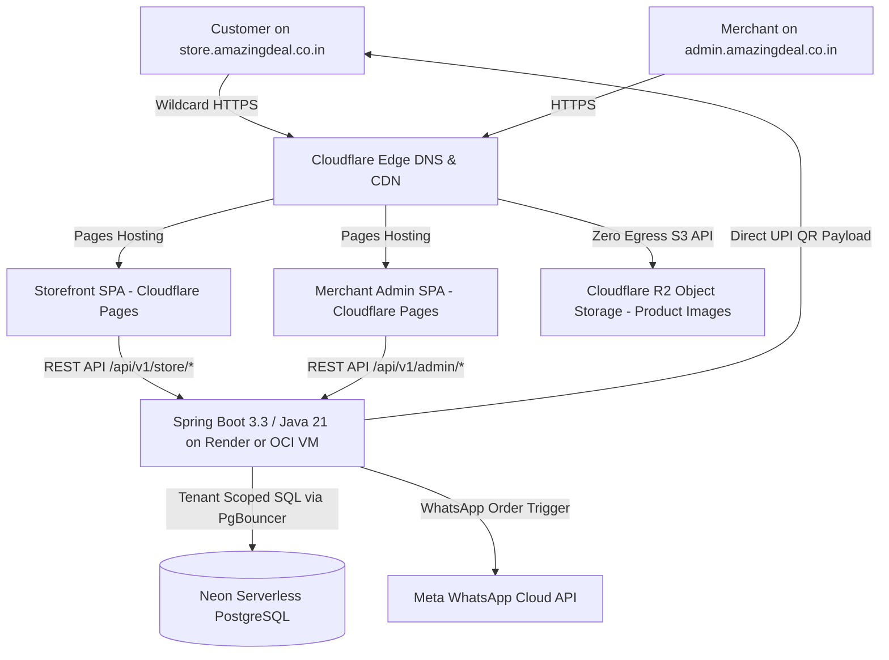

# AmazingDeal: Multi-Tenant Hyperlocal E-Commerce Platform (`amazingdeal.co.in`)
## Cloud-First Project Roadmap & Architecture Plan

> **Domain:** `amazingdeal.co.in`  
> **Deployment Strategy:** 100% Cloud-native from Day 1 on Zero-Cost / Generous Free Tier infrastructure (Neon Serverless Postgres, Render / OCI VM, Cloudflare Pages, Cloudflare R2, Cloudflare Wildcard DNS & SSL).

---

## 1. System Architecture Blueprint

---

## 2. Zero-Cost Cloud Infrastructure Specifications

| Layer | Service / Provider | Free Tier Limits | Purpose in AmazingDeal |
| :--- | :--- | :--- | :--- |
| **Backend API** | Render Web Service (or OCI Always Free ARM VM) | Free Tier (512MB RAM on Render / 24GB on OCI) | Runs Spring Boot container, REST APIs, multi-tenant resolution |
| **Database** | Neon Serverless PostgreSQL | 0.5 GB storage, auto-suspend, instant SSL pooling | Tenant-scoped data with discriminator column & RLS |
| **Object Storage** | Cloudflare R2 | 10 GB storage, 0 egress fees, 10M reads/mo | Product images, store logos, banner uploads |
| **Merchant Admin** | Cloudflare Pages | Unlimited bandwidth, global Anycast edge | `admin.amazingdeal.co.in` merchant dashboard |
| **Storefront** | Cloudflare Pages | Wildcard domain routing support | Dynamic customer storefronts at `*.amazingdeal.co.in` |
| **DNS & SSL** | Cloudflare Free Plan | Free Wildcard SSL (`*.amazingdeal.co.in`) | Edge SSL termination, DDoS protection |
| **Uptime Keeper** | Cron-job.org / UptimeRobot | Free (pings every 10 mins) | Prevents backend cold-starts on Render free tier |

---

## 3. Multi-Tenancy Architecture Design

### A. Tenant Identification Strategy
1. **Storefront Requests:**
   - Host Header: `https://sharmagrocery.amazingdeal.co.in`
   - Subdomain extractor pulls `sharmagrocery`.
   - `TenantResolver` queries cache/DB for `Tenant` matching `subdomain = 'sharmagrocery'`.
   - Sets `TenantContext.setTenantId(tenant.getId())`.
2. **Merchant Admin Requests:**
   - Authenticated JWT contains `tenant_id` claim.
   - Fallback / API Key: `X-Tenant-ID` header.
   - `TenantFilter` validates and binds `tenant_id` to current `ThreadLocal`.
3. **Tenant Data Isolation:**
   - Every tenant-scoped entity extends `TenantAwareEntity`.
   - Hibernate `@FilterDef(name = "tenantFilter")` automatically injects `AND tenant_id = :tenantId` into every JPA query.
   - Pre-persist `@PrePersist` hook automatically injects current `tenantId` into newly created entities.
   - RLS (Row-Level Security) policies enabled on PostgreSQL for defense-in-depth.

---

## 4. Database Schema Specification

### 1. `tenants`
- `id` UUID PRIMARY KEY DEFAULT gen_random_uuid()
- `store_name` VARCHAR(255) NOT NULL
- `subdomain` VARCHAR(100) NOT NULL UNIQUE
- `custom_domain` VARCHAR(255) UNIQUE
- `owner_phone` VARCHAR(20) NOT NULL
- `owner_email` VARCHAR(255) NOT NULL UNIQUE
- `password_hash` VARCHAR(255) NOT NULL
- `status` VARCHAR(20) NOT NULL DEFAULT 'ACTIVE'
- `settings` JSONB (delivery radius, min order, timings, upi_vpa, currency)
- `created_at` TIMESTAMP WITH TIME ZONE DEFAULT CURRENT_TIMESTAMP
- `updated_at` TIMESTAMP WITH TIME ZONE DEFAULT CURRENT_TIMESTAMP

### 2. `products`
- `id` UUID PRIMARY KEY DEFAULT gen_random_uuid()
- `tenant_id` UUID NOT NULL REFERENCES tenants(id) ON DELETE CASCADE
- `title` VARCHAR(255) NOT NULL
- `description` TEXT
- `price` NUMERIC(10,2) NOT NULL
- `compare_price` NUMERIC(10,2)
- `inventory_quantity` INTEGER DEFAULT 0
- `tracks_inventory` BOOLEAN DEFAULT TRUE
- `images` JSONB DEFAULT '[]'::jsonb
- `category` VARCHAR(100)
- `status` VARCHAR(20) NOT NULL DEFAULT 'ACTIVE' -- ACTIVE, OUT_OF_STOCK, DRAFT
- `created_at` TIMESTAMP WITH TIME ZONE DEFAULT CURRENT_TIMESTAMP
- `updated_at` TIMESTAMP WITH TIME ZONE DEFAULT CURRENT_TIMESTAMP
- *Index:* `idx_products_tenant_id`, `idx_products_category`

### 3. `orders`
- `id` UUID PRIMARY KEY DEFAULT gen_random_uuid()
- `tenant_id` UUID NOT NULL REFERENCES tenants(id) ON DELETE CASCADE
- `order_number` VARCHAR(50) NOT NULL
- `customer_name` VARCHAR(255) NOT NULL
- `customer_phone` VARCHAR(20) NOT NULL
- `delivery_address` TEXT NOT NULL
- `delivery_type` VARCHAR(20) NOT NULL DEFAULT 'DELIVERY' -- DELIVERY, PICKUP
- `payment_method` VARCHAR(20) NOT NULL DEFAULT 'COD' -- COD, UPI_ONLINE
- `payment_status` VARCHAR(20) NOT NULL DEFAULT 'PENDING' -- PENDING, PAID, FAILED
- `order_status` VARCHAR(30) NOT NULL DEFAULT 'PLACED' -- PLACED, ACCEPTED, PACKED, DELIVERED, CANCELLED
- `total_amount` NUMERIC(10,2) NOT NULL
- `delivery_charge` NUMERIC(10,2) DEFAULT 0.00
- `items` JSONB NOT NULL
- `created_at` TIMESTAMP WITH TIME ZONE DEFAULT CURRENT_TIMESTAMP
- *Index:* `idx_orders_tenant_id`, `idx_orders_created_at`

---

## 5. Execution Milestones & Checklist

### Phase 1: Spring Boot Multi-Tenant Core (In Progress)
- [x] Architecture & Schema design
- [ ] Initialize Spring Boot 3.3.x (Java 21) project with Maven wrapper
- [ ] Implement `TenantContext`, `TenantFilter`, `TenantResolver`
- [ ] Base `TenantAwareEntity` with Hibernate `@Filter` and JPA audit hooks
- [ ] Multi-stage production `Dockerfile` (`eclipse-temurin:21-jre-alpine`)
- [ ] Cloud-ready `application.yml` supporting Neon PostgreSQL SSL connection strings

### Phase 2: Core Merchant & Storefront APIs
- [ ] Auth & Onboarding: `POST /api/v1/auth/register-store`, `POST /api/v1/auth/login`
- [ ] Merchant Catalog: CRUD `/api/v1/admin/products`, inventory toggle
- [ ] Pre-signed R2 image upload endpoint `/api/v1/admin/media/upload-url`
- [ ] Public Storefront: `/api/v1/store/info`, `/api/v1/store/products`, `/api/v1/store/orders`
- [ ] Dynamic UPI QR code payload generator (`upi://pay?pa={vpa}&pn={name}&am={amount}&tn={order}`)
- [ ] 58mm/80mm Thermal Receipt Generator endpoint

### Phase 3: Merchant Dashboard Frontend (`frontend-admin`)
- [ ] Vite + React + TypeScript + Tailwind CSS setup
- [ ] Mobile-first dashboard layout with live store stats
- [ ] Live incoming order board with audible notification chime
- [ ] Product catalog manager with image preview and 1-tap stock toggle
- [ ] Store settings panel (UPI VPA, delivery fees, timings)
- [ ] Thermal receipt print preview

### Phase 4: Customer Storefront Frontend (`frontend-storefront`)
- [ ] Subdomain-aware client hook (`useSubdomain`)
- [ ] Mobile-optimized product catalog with category filter & instant search
- [ ] Slide-out cart bottom-sheet
- [ ] 1-step checkout modal (Name, Mobile, Address, Delivery/Pickup)
- [ ] Instant UPI QR payment modal & Direct Intent App link (GPay, PhonePe, Paytm)

### Phase 5: Cloud Deployment & Production Configuration
- [ ] `render.yaml` backend cloud blueprint
- [ ] Cloudflare Pages configuration for Admin and Storefront
- [ ] Cloudflare DNS Wildcard SSL setup guide for `*.amazingdeal.co.in`
- [ ] Neon Serverless PostgreSQL connection guide
- [ ] Cloudflare R2 bucket setup guide
